<div align="center">


<br />
<br />

<a href="https://monolito-three.vercel.app"></a>


<br />

<sub>

**[A ideia](#-a-ideia)** &nbsp;◆&nbsp; **[A jornada](#-a-jornada)** &nbsp;◆&nbsp; **[Os projetos](#-os-projetos)** &nbsp;◆&nbsp; **[Por dentro](#-por-dentro)** &nbsp;◆&nbsp; **[Rodando](#-rodando-localmente)** &nbsp;◆&nbsp; **[Créditos](#-créditos)**

</sub>

</div>

<br />

<a href="https://monolito-three.vercel.app">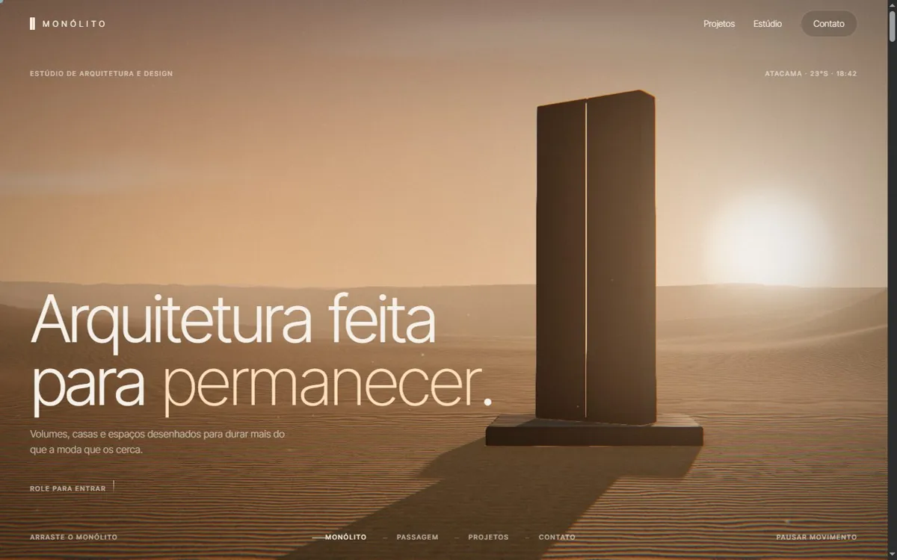</a>

## ◆ A ideia

> *Toda forma começa fechada.*

**MONÓLITO** é o site de um estúdio fictício de arquitetura e design. Em vez de uma página com fotos, o site é **uma única cena 3D que a rolagem atravessa**: um monólito no deserto do Atacama ao entardecer se abre, a câmera entra por um corredor de luz e sai dentro de quatro projetos em escala real, cada um no seu lugar e na sua hora do dia.

A referência principal foi a [Apricode](https://apricode.agency/), com [Dokmeh](https://hidokmeh.com/) e [Kinoria](https://kinoria.studio/) de apoio. O que veio delas foi a lógica, não o visual: a página inteira como uma jornada 3D guiada pela rolagem, um objeto central com material de verdade e a interface reduzida ao mínimo.

<br />

<table>
<tr>
<td width="33%" valign="top">

### ◇ &nbsp;Cinematográfico
Luz de HDRIs reais, tone mapping AgX, bloom, oclusão de ambiente (N8AO), anti-aliasing (SMAA), profundidade de campo e grão de filme. A câmera faz uma grua na entrada e acelera a lente com a velocidade da rolagem.

</td>
<td width="33%" valign="top">

### ◇ &nbsp;Interativo
O cursor move o sol e as sombras. Dá para girar o monólito e orbitar cada edifício arrastando. A abertura e o fechamento da porta seguem a rolagem quadro a quadro, então voltar a rolar desfaz tudo.

</td>
<td width="33%" valign="top">

### ◇ &nbsp;Sem framework
HTML, CSS e JavaScript em ES modules, sem build. Bibliotecas por CDN com versão fixa. O hero não espera os projetos carregarem, e o celular recebe uma versão mais leve.

</td>
</tr>
</table>

<br />

## ◆ A jornada

<table>
<tr>
<td width="50%">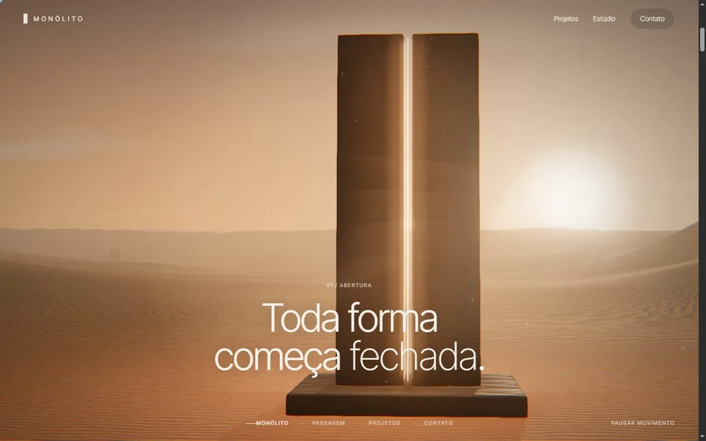<br /><sub><b>01 · Abertura</b>: uma fresta de luz, uma pausa e o giro pesado das duas metades, com areia escorrendo das bordas</sub></td>
<td width="50%">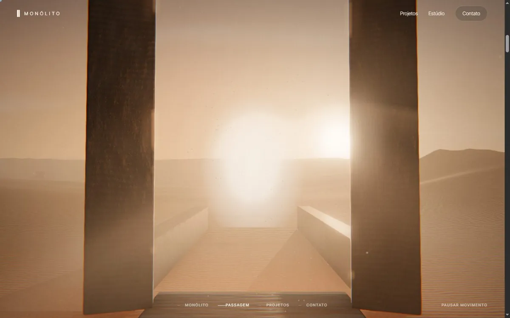<br /><sub><b>02 · Giro</b>: as metades se afastam e a câmera atravessa a passagem, com um leve tremor do peso da pedra</sub></td>
</tr>
<tr>
<td width="50%">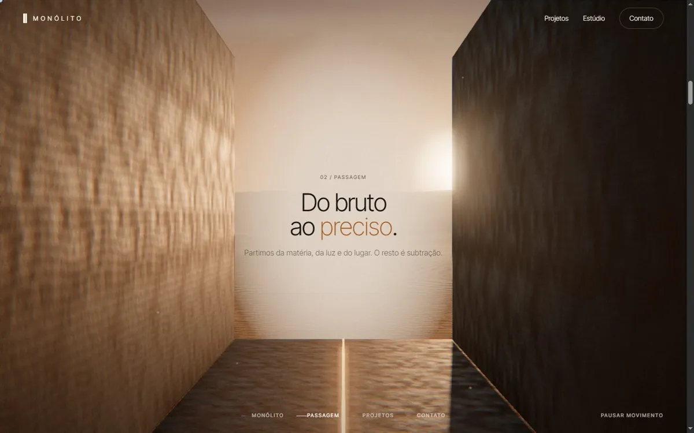<br /><sub><b>03 · Passagem</b>: duas paredes de taipa sobem da areia e formam um corredor de luz</sub></td>
<td width="50%">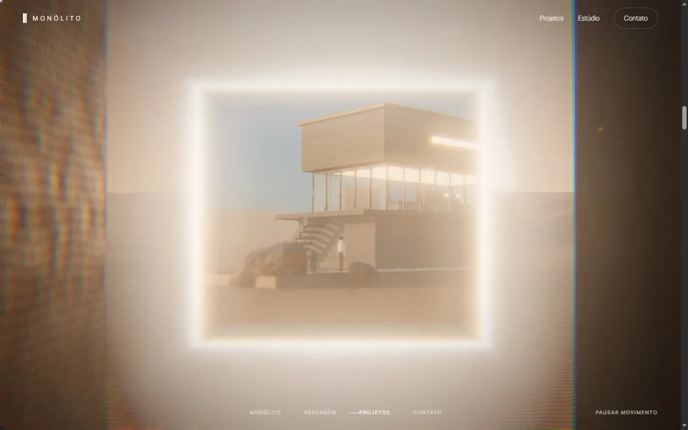<br /><sub><b>04 · Porta de luz</b>: a luz no fim do corredor vira uma porta que cresce até revelar o primeiro projeto</sub></td>
</tr>
</table>

<br />

## ◆ Os projetos

Quatro edifícios fictícios, em escala real e com vida. Entre um e outro, uma **fenda vertical de luz** se abre no centro da tela e revela o próximo, o mesmo gesto do monólito.

<table>
<tr>
<td width="50%">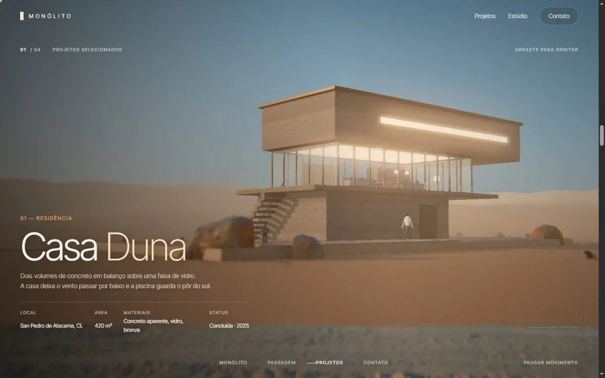<br /><sub><b>Casa Duna</b> · San Pedro de Atacama, CL<br />Volumes de concreto em balanço, interior aceso com mobiliário, piscina com reflexo e pessoas no deck.</sub></td>
<td width="50%">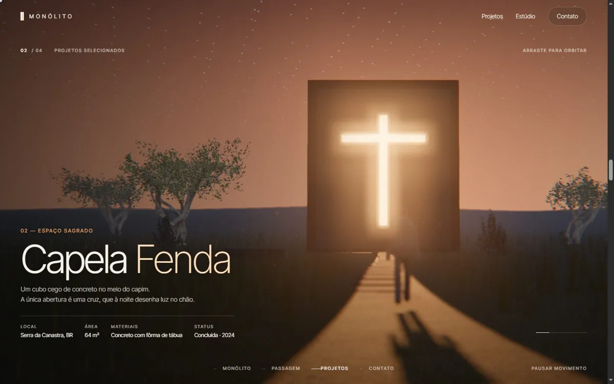<br /><sub><b>Capela Fenda</b> · Serra da Canastra, BR<br />Um cubo cego de concreto na hora azul. A luz de dentro sai pela cruz; capim ao vento e vaga-lumes.</sub></td>
</tr>
<tr>
<td width="50%">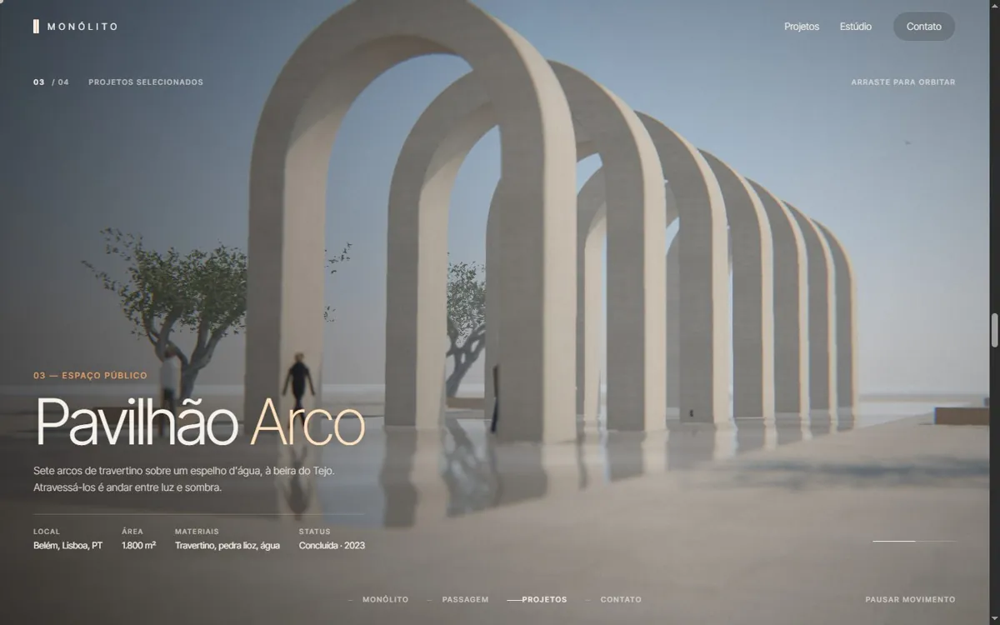<br /><sub><b>Pavilhão Arco</b> · Belém, Lisboa, PT<br />Sete arcos sobre um espelho d'água à beira do Tejo, com sombras em ritmo, pessoas e gaivotas.</sub></td>
<td width="50%">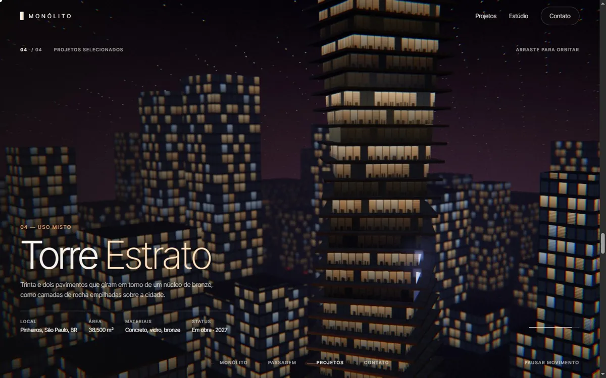<br /><sub><b>Torre Estrato</b> · Pinheiros, São Paulo, BR<br />Trinta e dois andares girados em torno de um núcleo de bronze, com a cidade e o trânsito à noite.</sub></td>
</tr>
</table>

<table>
<tr>
<td width="70%">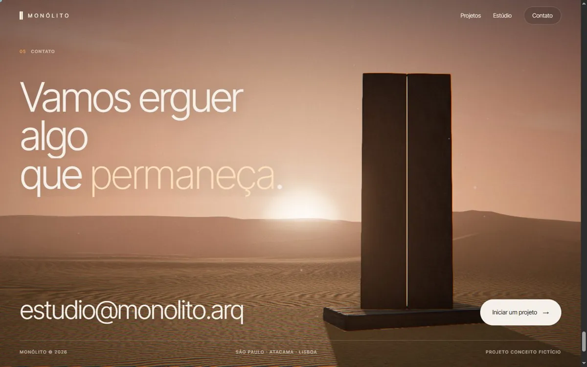<br /><sub><b>05 · Contato</b>: de volta ao deserto ao anoitecer. As metades aceleram até o impacto, com poeira, onda de choque na areia e um clarão na fenda</sub></td>
<td width="15%">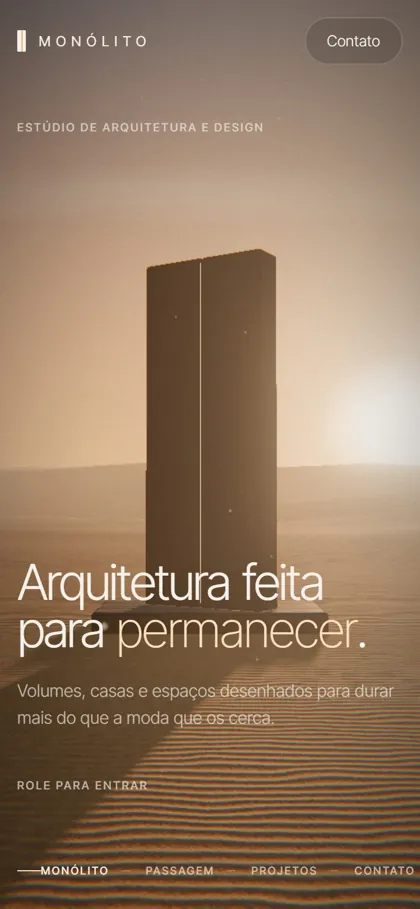<br /><sub>Celular</sub></td>
<td width="15%">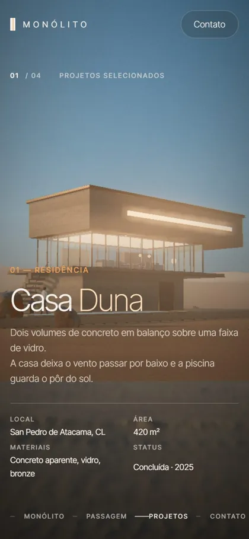<br /><sub>Projetos no celular</sub></td>
</tr>
</table>

<br />

## ◆ Por dentro

| Arquivo | O que faz |
|---|---|
| `engine.js` | Renderizador, pós-processamento e o `WorldMixPass`, que mistura dois mundos por uma máscara de luz (porta ou fenda) com borda em HDR para o bloom |
| `desert.js` | Deserto: céu em shader com nuvens, dunas com cristas, monólito, corredor e a coreografia da porta (areia, poeira, onda de choque, tremor) |
| `projects.js` | Os quatro projetos: cenário, luz, câmera por quadros-chave, pessoas, vegetação e animação |
| `kit.js` | Peças compartilhadas: HDRI, materiais PBR em escala real, água, pessoas e carregamento de modelos |
| `hdr-worker.js` | Decodifica o HDRI fora da thread principal e alinha o sol do panorama com o da cena |
| `main.js` | Loader, rolagem (Lenis + ScrollTrigger), textos revelados por máscara, cursor e troca de mundos |
| `blender/` | Scripts Python que modelam a Casa Duna e a Capela no Blender e fazem o bake da oclusão |

**Desempenho e robustez**

- **Celular:** sem oclusão de ambiente, sem SMAA, sem desfoque e sem reflexos, com DPR de no máximo 1,25 e HDRI 1K.
- **Carregamento:** o hero aparece sem esperar os projetos, que carregam em segundo plano.
- **Sem WebGL:** quando o navegador não oferece WebGL (por exemplo, com a aceleração gráfica desligada), entra uma versão estática.
- **Movimento reduzido:** respeita `prefers-reduced-motion` e tem um botão "Pausar movimento".

> **Requisito:** navegador com **aceleração gráfica ligada** (WebGL 2). Se o 3D ficar travando, confira em `chrome://gpu` ou `brave://gpu` se o `GL_RENDERER` mostra a sua placa de vídeo, e não "Basic Render Driver" ou "SwiftShader".

<br />

## ◆ Rodando localmente

O site é estático, mas usa ES modules e Web Workers, então precisa de um servidor (abrir o `index.html` direto no navegador não funciona):

```bash
npx -y http-server@14.1.1 . -p 5175 -c-1
```

Depois é só abrir `http://localhost:5175`. O deploy é na Vercel, sem configuração: qualquer push em `main` publica.

<br />

## ◆ Créditos

- **HDRIs, texturas PBR e vegetação:** [Poly Haven](https://polyhaven.com), licença CC0. A lista completa está em [`assets/CREDITOS.md`](assets/CREDITOS.md).
- **Bibliotecas:** [three.js](https://threejs.org) r160, [GSAP](https://gsap.com) 3.12 (ScrollTrigger e CustomEase), [Lenis](https://lenis.darkroom.engineering) 1.1 e [N8AO](https://github.com/N8python/n8ao) 1.9.
- **Fonte:** [Inter Tight](https://fonts.google.com/specimen/Inter+Tight).
- **Modelos da Casa Duna e da Capela:** gerados no [Blender](https://www.blender.org) 5.2 pelos scripts em `blender/`.

O processo de realismo, com notas, capturas de antes e depois e números de desempenho, está em [`RELATORIO-REALISMO.md`](RELATORIO-REALISMO.md).

<br />

<div align="center">
<sub>Projeto conceito de portfólio por <a href="https://github.com/gabrielnovaesdev">Gabriel Novaes</a>. O estúdio, os projetos e os textos são fictícios.</sub>
</div>
